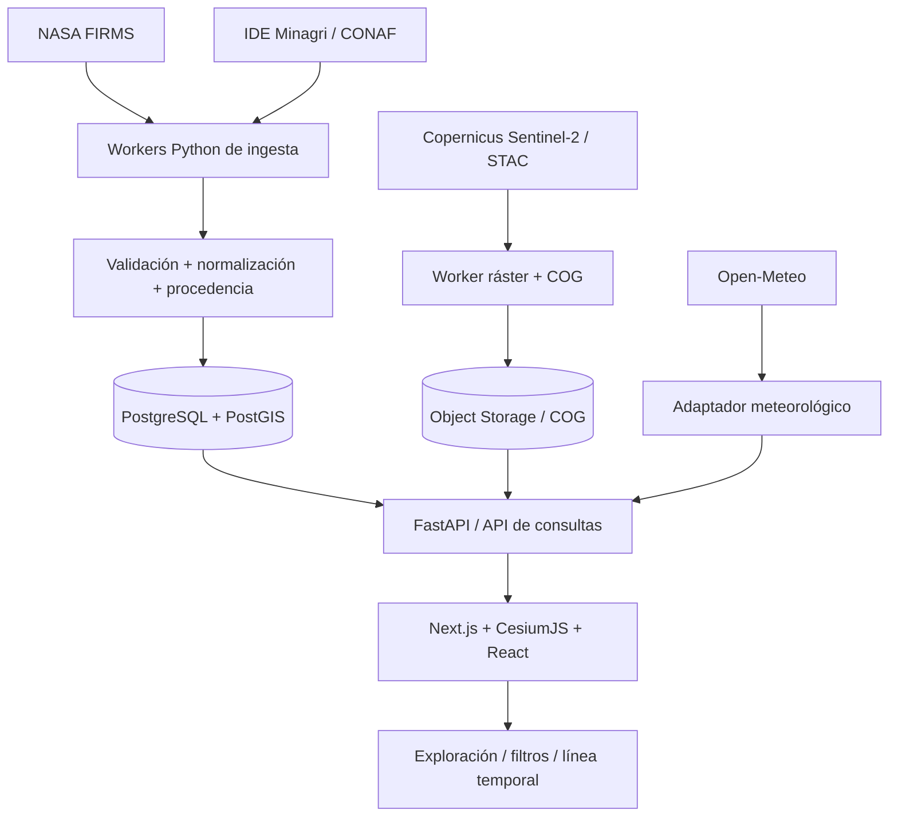

# Arquitectura — BRASA Chile

## Esquema recomendado para producción



**MVP actual**: FastAPI proporciona API y frontend estático CesiumJS. El procesamiento es directo y en memoria, sin base de datos. Un prototipo así no debe publicarse como plataforma de emergencia ni usarse con tráfico elevado.

## Entidades del dominio

- **Observation**: medición puntual del satélite, con producto, timestamp UTC, coordenadas, FRP, brillo, calidad/confianza, descarga y origen.
- **Incident**: incendio nombrado con estado, ID de origen, entidad que lo confirma y evolución de estados temporalmente versionada. Las observaciones pueden *no* pertenecer a un incidente.
- **BurnedArea**: geometría final o parcial, fecha de producción del polígono, temporalidad representada, superficie, método, calidad y fuente.
- **HistoricalSnapshot**: vista de un incidente en un instante/intervalo; solo existe con datos observados para ese momento.
- **WeatherObservation/WeatherEstimate**: medición o salida de modelo, fecha válida, modelo/estación, resolución y coordenada.
- **SourceRevision**: captura inmutable de la procedencia, URL, licencia, versión, descarga y hash.
- **AdministrativeArea**: límite poligonal oficial para filtrar por comuna y región, con origen/versionado.

## SQL base (orientativo para PostGIS)

```sql
CREATE EXTENSION IF NOT EXISTS postgis;

CREATE TABLE data_sources (
  id BIGINT GENERATED ALWAYS AS IDENTITY PRIMARY KEY,
  provider TEXT NOT NULL,
  product TEXT NOT NULL,
  original_url TEXT,
  retrieved_at TIMESTAMPTZ NOT NULL DEFAULT now(),
  licence_note TEXT,
  source_hash TEXT,
  UNIQUE(provider, product, source_hash)
);

CREATE TABLE fire_observations (
  id BIGINT GENERATED ALWAYS AS IDENTITY PRIMARY KEY,
  source_id BIGINT NOT NULL REFERENCES data_sources(id),
  provider_record_key TEXT NOT NULL,
  observed_at TIMESTAMPTZ NOT NULL,
  location GEOMETRY(Point, 4326) NOT NULL,
  frp_mw DOUBLE PRECISION,
  brightness_kelvin DOUBLE PRECISION,
  confidence_raw TEXT,
  quality_flags JSONB NOT NULL DEFAULT '{}',
  ingested_at TIMESTAMPTZ NOT NULL DEFAULT now(),
  UNIQUE(source_id, provider_record_key)
);
CREATE INDEX obs_location_gist ON fire_observations USING GIST(location);
CREATE INDEX obs_time_btree ON fire_observations(observed_at DESC);

CREATE TABLE admin_areas (
  id BIGINT GENERATED ALWAYS AS IDENTITY PRIMARY KEY,
  area_code TEXT NOT NULL,
  area_type TEXT NOT NULL,
  name TEXT NOT NULL,
  geom GEOMETRY(MultiPolygon,4326) NOT NULL,
  source_id BIGINT REFERENCES data_sources(id),
  UNIQUE(area_type, area_code)
);
CREATE INDEX admin_geom_gist ON admin_areas USING GIST(geom);

CREATE TABLE fire_incidents (
  id UUID PRIMARY KEY DEFAULT gen_random_uuid(),
  name TEXT NOT NULL,
  official_id TEXT,
  official_status TEXT,
  status_valid_at TIMESTAMPTZ,
  source_id BIGINT REFERENCES data_sources(id),
  confirmed BOOLEAN NOT NULL DEFAULT FALSE,
  created_at TIMESTAMPTZ NOT NULL DEFAULT now()
);

CREATE TABLE incident_polygons (
  id BIGINT GENERATED ALWAYS AS IDENTITY PRIMARY KEY,
  incident_id UUID REFERENCES fire_incidents(id),
  source_id BIGINT NOT NULL REFERENCES data_sources(id),
  geom GEOMETRY(MultiPolygon,4326) NOT NULL,
  valid_at TIMESTAMPTZ,
  shape_kind TEXT NOT NULL CHECK(shape_kind IN ('final_burned_area','observed_perimeter','estimated_area')),
  method TEXT NOT NULL,
  uncertainty_note TEXT,
  created_at TIMESTAMPTZ NOT NULL DEFAULT now()
);
CREATE INDEX incident_polygons_gist ON incident_polygons USING GIST(geom);
```

Nota: al indexar datos NOAA, usar identificadores de fuente coherentes para que reprocesamientos no dupliquen detecciones. La capa `data_sources` aquí modela lotes; en producción separar catálogo de producto y lote de ingestión. Asociar un hotspot a un incidente únicamente con criterios definidos, registrando incertidumbre. El SQL de arriba es **borrador de arquitectura**, no migración del MVP implementado.

## Endpoints objetivos

```text
GET /v1/observations?bbox=...&from=...&to=...&source=...
GET /v1/observations/stats?region_code=...&from=...&to=...
GET /v1/incidents?season=...&region_code=...
GET /v1/incidents/{id}/timeline
GET /v1/areas/{id}/perimeters?at=...
GET /v1/satellite/assets?bbox=...&from=...&cloud_max=...
GET /v1/meteo?lat=...&lon=...&at=...&kind=forecast|historical
GET /v1/sources/{id}/provenance
```

Respuestas recomendadas: GeoJSON o esquema de puntos binario/vector tiles para grandes volúmenes; cada endpoint debe exponer `data_as_of`, `source_product`, `acquisition_at`, `ingested_at`, `valid_at`, `limitations` y `licence` cuando sea relevante. Permitir `bbox` validado, límites temporales y paginación; no ofrecer búsquedas sin límite.

## Ingesta y trazabilidad

1. Scheduler regular consulta NOAA-21/NOAA-20 por región, con caché y límites. No sincronizar una solicitud externa con cada pan/zoom de usuario.
2. Retener copia del CSV original (object storage), checksum, fecha/hora de adquisición y metadatos.
3. Normalizar unidades y observaciones en WGS84 (EPSG:4326). Para región usar `ST_Intersects` / `ST_Covers` contra contorno oficial, no cajas aproximadas.
4. Upsert idempotente que tolere productos corregidos y reingestas.
5. Generar agregados y GeoJSON de baja densidad o vector tiles para frontend. Nunca usar el total de puntos de un periodo como el número oficial de incendios.
6. Anexar la actualización actual del proveedor sin borrar resultados históricos si el servidor externo falla.

## Sentinel-2 y escenarios históricos

La API STAC de Copernicus sirve para *buscar* productos, no para interpretar automáticamente un polígono de quemado. El pipeline separado debe seleccionar imágenes comparables antes/después, verificar nubosidad y geometría, reproyectar y producir mosaicos/COG. `NBR = (NIR-SWIR)/(NIR+SWIR)` y `dNBR = NBR_pre-NBR_post` son indicadores que requieren umbrales contextualizados y validación; **no** equivalen por sí solos a delimitación oficial.

El reporte debe mostrar fecha de cada imagen, escala/ resolución, máscara de nubes, método y grado de incertidumbre. Los polígonos de CONAF pueden describir extensión total final; nunca se les atribuyen timestamps de propagación que no fueron observados.

## Diseño, experiencia y accesibilidad

- Interfaz editorial cartográfica con visualización 3D como foco, filtros a la izquierda y observaciones a la derecha.
- Colores de puntos por FRP son **simbología ilustrativa**, no escala de gravedad validada.
- Modo de reproducción día a día con timestamp visible; más adelante animación intradía si observaciones reales lo permiten.
- No añadir drones, recursos terrestres ni telemetría simulada en el tablero de datos reales.
- Aplicar clustering/tiled vector layers progresivos. Un mapa 3D potente no justifica bloquear dispositivos modestos.
- Mantener fallback 2D y modo bajo consumo; idioma español de Chile, timezone `America/Santiago`, UTC en almacenamiento.

## Infraestructura y responsabilidades

- **Frontend producción:** Next.js / React + CesiumJS (bundle local, no depender de CDN público en producción), hosting estático o híbrido.
- **Backend:** FastAPI, endpoints geoespaciales y autenticación de administradores.
- **Persistencia:** Supabase PostgreSQL + PostGIS al principio; más adelante Postgres administrado si crece el dataset.
- **Ingesta:** proceso Python programado o queue worker (fuera de límites de serverless request). Separado de rendering.
- **Rásteres:** buckets compatibles con S3, Cloud Optimized GeoTIFF + servicio de teselas, CDN y política de expiración.
- **Observabilidad:** uptime, alertas por falta de novedades, tasa de fallos proveedor, últimas observaciones y tiempo de procesamiento.
- **Seguridad:** credenciales privadas del servidor, tokens de mapas públicos y restringidos por dominio, CORS controlado, rate limiting, backups y mínimo acceso.

## Riesgos principales

| Riesgo | Mitigación |
|---|---|
| Detección térmica mal interpretada | Etiquetas y metodologías; no usar `incendio activo` sin confirmación |
| Ausencia de paso satelital útil | Mostrar cobertura y latencia; no inferir que no existen incendios |
| Coordenadas fuera del territorio chileno | Límites oficiales, geometría multipoligonal, pruebas en fronteras e islas |
| Datos oficiales sin API | Integración pactada o carga programada permitida; jamás scraping agresivo |
| Productos NOAA/S-NPP discontinuados | Priorizar NOAA-21/20 y monitorizar changelogs |
| Falso contorno temporal | Representar sólo observaciones georreferenciadas con fecha real |
| Altos costos de mapas/ráster | Cache, bbox tiles, cuotas, presupuestos y avisos de gasto |
| Uso indebido para emergencias | Advertencias, enlaces oficiales, metodología y revisión de especialistas |
