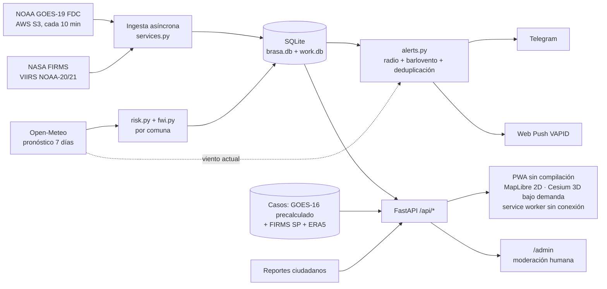

# Arquitectura — BRASA Chile

## Qué es BRASA

Sistema ciudadano de alerta de incendios forestales para Chile: detecciones térmicas
satelitales (GOES-19 cada ~10 min, VIIRS/MODIS vía FIRMS) agrupadas en incidentes, avisos
por lugar guardado, riesgo por comuna, fuentes oficiales de CONAF y la DMC, y
reconstrucción de incendios históricos. Complementa a SENAPRED y CONAF; no emite alertas
oficiales.

La regla de oro: **un punto de calor no es un incendio**. Las detecciones se agrupan en
incidentes con estados `anomalia → posible → reportado`, y `confirmado`/`controlado` solo
llega vía una fuente oficial (CONAF). Todo el sistema —etiquetas, avisos y textos— está
construido alrededor de esa distinción.

## Mapa de módulos

`backend/` (los paquetes `routes/` y `notify/` se describen tras la tabla):

| Archivo | Qué hace | Depende de |
|---|---|---|
| `alerts.py` | Avisos por lugar guardado: niveles `aviso`/`urgente`, deduplicación, recordatorio único de urgente, `evaluate` (satélite) y `evaluate_official` (CONAF) | `incidents`, `reports`, `db`, `geo`, `providers/dmc` |
| `cases.py` | Reconstrucción de casos históricos: línea temporal y huella acumulada de detecciones (no es el perímetro oficial) | `settings` (`web/data/cases.json`), shapely/numpy |
| `censo.py` | Exposición del Censo 2024 por comuna (población, viviendas, hogares) desde `web/data/censo_2024.json`; si falta, sale en None | `settings` (`web/data`) |
| `db.py` | Persistencia SQLite en dos archivos: `brasa.db` (personas) + `work.db` adjunta como `work` (reconstruible) | solo stdlib |
| `diagnostics.py` | Resumen de errores de la ingesta (24 h) para `/api/status`, sin datos personales | `db`, `services` |
| `freshness.py` | Regla única de frescura del dato satelital (30 min) que comparten todas las vistas | solo stdlib |
| `fwi.py` | Índice canadiense FWI por comuna (FFMC→DMC→DC→ISI→BUI→FWI) con tabla del hemisferio sur | solo stdlib |
| `geo.py` | Comunas reales (BCN) con índice `STRtree`, distancias geodésicas, rumbos y regla de barlovento | `settings`, shapely |
| `historia.py` | Historia de incendios CONAF-GEPRIF por comuna (`historia-comunas.json` y `temporada-2526.json`), emparejada por nombre normalizado; si falta el archivo sale en None | `geo`, `settings` (`web/data`) |
| `incidents.py` | Agrupa detecciones en incidentes, estados, fuentes de calor fijas, `expire` y `prune` | `db`, `geo`, `settings` |
| `lluvia.py` | Peor ventana de lluvia en 3 h e isoterma 0 °C (insumo del futuro aviso de aluvión; no gatilla avisos aún) | solo stdlib |
| `main.py` | App FastAPI: lifespan, middlewares, inclusión de routers y archivos estáticos | `security`, `version`, `geo`, `og`, `settings`, `services`, `routes/*` |
| `og.py` | `/i/<id>` con etiquetas Open Graph y `/og/incident/<id>.png` (Pillow) para compartir fichas | `cases`, `incidents`, `routes`, `services`, `settings`, PIL |
| `rain.py` | Anomalía de lluvia de la temporada fría (jun–oct) vs. normal 1991-2020, por comuna | solo stdlib (+ datos en `web/data`) |
| `reports.py` | Reportes ciudadanos: re-codificación de fotos sin EXIF, publicación solo con revisión humana, caducidad por tipo | solo stdlib |
| `response.py` | Tiempos de respuesta de CONAF (detección→aviso→despacho) desde el CSV de GEPRIF | solo stdlib |
| `risk.py` | Índice diario 30-30-30 por comuna combinado con el FWI (`combine`) | solo stdlib |
| `scars.py` | Cicatrices de la temporada: unión por comuna de las huellas de detecciones (dato abierto; no es el perímetro oficial) | `cases`, `incidents`, `db`, `geo`, shapely |
| `security.py` | CSP de las páginas; debe ser idéntica a la del Worker (`deploy/cloudflare/src/index.ts`, lo verifica `tests/test_security.py`) | `settings` |
| `services.py` | Servicios compartidos y todo el ciclo de ingesta: `tick`, `ingest_cycle`, `deliver`, respaldos y retención | casi todo lo anterior + `notify/*` + `providers/*` |
| `settings.py` | Configuración desde `.env`/entorno; ningún secreto sale al navegador | python-dotenv |
| `spread.py` | Arma el escenario estimado de propagación (`estimate`) con FFMC y viento guardados de la comuna; lo comparten la ficha y los avisos, con la misma frescura | `fwi`, `db` |
| `storage.py` | Respaldo remoto de `brasa.db`, fotos y `work.db` (R2 vía `/_internal/storage` del Worker) | `db`, httpx |
| `trend.py` | Compara el pronóstico de riesgo de hoy con el emitido hace 7 días (`risk_snapshot`) | `risk` |
| `version.py` | `VERSION` de la API y la web | — |

`backend/providers/`:

| Archivo | Qué hace | Depende de |
|---|---|---|
| `_retry.py` | Reintentos ante errores transitorios (429/5xx/red); un 4xx no se reintenta | httpx |
| `conaf.py` | CONAF: Botón Rojo (capa ArcGIS) e incendios informados (CSV público de GEPRIF) | httpx |
| `conaf_dei.py` | CONAF-GEPRIF: perímetro oficial «Perimetro_final» por envelope (OFI-17, tras `CONAF_PERIMETRO_ENABLED`) | `geo`, httpx |
| `dmc.py` | Avisos CAP 1.2 de la DMC (MeteoChile); solo viento y calor extremo, zonas cruzadas con comunas | httpx |
| `firms.py` | NASA FIRMS: detecciones VIIRS/MODIS (NRT y archivo SP), normaliza confianza | `_retry`, httpx |
| `glm.py` | Rayos del GLM de GOES (L2 LCFA) como posibles igniciones | `_retry`, `goes`, httpx, numpy |
| `goes.py` | Detecciones de fuego GOES ABI L2 FDC (G19 operacional, G16 histórico) desde AWS Open Data | `_retry`, httpx, numpy |
| `noaa.py` | Índice ONI de la NOAA (El Niño/La Niña) como contexto de temporada | httpx |
| `overpass.py` | OpenStreetMap vía Overpass: puntos de encuentro, hospitales y cuarteles cercanos | `_retry`, httpx |
| `smoke.py` | Máscara de humo GOES-19 ABI-L2-ADPF: «¿hacia dónde va el humo?» | `goes`, httpx, numpy |
| `weather.py` | Open-Meteo: pronóstico horario (riesgo), condiciones actuales (alertas), reanálisis ERA5 (casos) y cupo de llamadas | httpx |

Paquetes dentro de `backend/` (no entran en la tabla por ser directorios):

- `backend/routes/`: `public.py` (observaciones, incidentes, official-fires, riesgo), `personal.py`
  (suscriptores, lugares, resumen del lugar, familia), `community.py` (reportes y moderación),
  `climate.py` (FWI, lluvia, ENSO), `comuna.py` (ficha de comuna: riesgo, Botón Rojo, censo e
  incendios CONAF), `panorama.py` (totales y desglose regional de la temporada), `opendata.py`
  (datos descargables), `internal.py`
  (`/api/internal/*` con `X-Internal-Token`, bloqueadas por el Worker), `common.py` (helpers).
- `backend/notify/`: `webpush.py` (Web Push VAPID) y `telegram.py` (bot, formato de avisos).

## El ciclo de ingesta

Todo parte en `Services.tick`/`ingest_cycle` (`services.py`), disparado cada 10 minutos por
el Cron Trigger del Worker (`/api/internal/tick?wait=1`) o por el loop interno cuando el
scheduler local está activo (`INGEST_INTERVAL_MIN`). Orden y frecuencias:

| Fuente / tarea | Frecuencia | Escribe en (work.db salvo indicación) |
|---|---|---|
| FIRMS (VIIRS/MODIS) + GOES FDC, en paralelo | cada ciclo (10 min) | `observations` (idempotente), `ingest_runs` |
| `incidents.update` + `expire` | cada ciclo | `incidents`, `incident_observations`, `incident_merges` |
| `alerts.evaluate` + `deliver` | cada ciclo | `alerts` (brasa.db) |
| Incendios CONAF (`ingest_official_fires`) | cada ciclo | `official_fires`, `link_official` en `incidents`, avisos `evaluate_official` |
| FWI por comuna (`compute_fwi`) | una vez al día (`FWI_EVERY_H`) | `fwi_daily` |
| Riesgo 30-30-30 (`compute_risk`) | cada 180 min, con tope de `RISK_POINTS_PER_PASS` ubicaciones por pasada | `risk_daily`, `risk_hourly` |
| Foto del pronóstico (`capture_risk_snapshot`) | cada hora (guarda; la foto es diaria) | `risk_snapshot` |
| Avisos DMC (`ingest_dmc`) | cada hora | `dmc_alerts` |
| Ciclo de lluvia (`rain_cycle`) | normales cada 6 h; anomalía una vez al día (`RAIN_ANOMALY_EVERY_H`) | `rain_season`, `rain_normal` |
| Botón Rojo (`ingest_boton_rojo`) | cada 3 h | `boton_rojo` |
| Resumen preventivo (`daily_brief`) | al final de cada ciclo | avisos `dmc:`/`brief` en `alerts` |

Reglas transversales: una fuente caída se registra en `ingest_runs` y no detiene el resto;
al arrancar se rellenan las últimas horas de GOES (`backfill_goes`, ventana de 40 min con
tope de 4 barridos por ciclo); cada observación tiene id estable por producto, así que
reingerir no duplica ni reavisa; `alerts_evaluated_at` marca lo ya mirado y
`pending_alert_observations` recupera lo que quedó a medio procesar tras un reinicio.

## El camino de una petición

1. **Worker de Cloudflare** (`deploy/cloudflare/src/index.ts`): recibe todo el tráfico.
   Los estáticos salen de `ASSETS`; las rutas de la tabla `EDGE_CACHE_TTL`
   (`/api/observations`, `/api/incidents`, `/api/official-fires`, `/api/risk`,
   `/api/status`) se sirven desde la caché del borde (`caches.default`) con frescura de
   30-60 s, stale-while-revalidate y una copia máxima de 10 min si el contenedor no
   responde. Una recarga por clave por instancia (`edgeInflight`) evita la estampida.
   `/api/internal/*` exige `X-Internal-Token`.
2. **Contenedor** (`@cloudflare/containers` → uvicorn): `main.py` arma la app; la ruta en
   `backend/routes/` valida parámetros, consulta `db.py` y devuelve JSON con las cabeceras
   de `security.py`.
3. **SQLite**: `brasa.db` (personas: subscribers, places, alerts, reports, kv) +
   `work.db` adjunta como `work` (observations, incidents, official_fires, boton_rojo,
   risk_*, fwi_daily, dmc_alerts, rain_*, cache, ingest_runs). Las consultas no llevan
   prefijo: SQLite resuelve main y luego las adjuntas.

## El camino de un aviso

Detección nueva → `store_observations` (comuna asignada vía `geo.territory`) →
`incidents.update` (agrupa, fusiona, estados) → `alerts.evaluate`: descarta fuentes fijas
y detecciones viejas, calcula nivel (`urgente` si el viento sopla hacia el lugar, foco a
≤ 2 km, o ≤ 5 km en día de riesgo alto/extremo, o persona que necesita más tiempo) y
deduplica 12 h / 3 km → `deliver`: marca `delivered_at` por canal tras enviar Web Push
(`notify/webpush.py`) y/o Telegram (`notify/telegram.py`); lo pendiente se reintenta en el
próximo ciclo desde la base, y un `urgente` sin aviso más nuevo se reenvía una sola vez
(`reminded_at`). La vía CONAF es paralela: `ingest_official_fires` → `link_official` →
`alerts.evaluate_official` («CONAF informa») → mismo `deliver`.

## Estado y respaldos

- `brasa.db`: lo irreconstruible (dispositivos, lugares, avisos, reportes, claves VAPID).
  `storage.py` la sube a R2 tras cada cambio (`/_internal/storage` con `INTERNAL_TOKEN`).
- `work.db`: reconstruible, pero conserva la historia de incidentes; se sube comprimida
  cada hora (`WORK_EVERY_S`) y se restaura al arrancar, de mejor esfuerzo.
- Retención (FIX-21, `services.py`): observaciones 45 días (`RETENTION_DAYS`, con
  `incidents.prune` al mismo corte); avisos 365 días; reportes sin verificar/descartados
  90 días y verificados 730; fotos borradas del disco al purgar; fotos del pronóstico
  120 días; filas de Botón Rojo 14 días. `purge_user_data` corre en cada ciclo y su fallo
  no detiene la ingesta.

## Lo que es objetivo y no está hecho

El diseño de referencia (PostGIS, workers separados, rásteres COG) y los pendientes vivos
están en [`docs/BACKLOG_MAESTRO.md`](BACKLOG_MAESTRO.md). Las secciones siguientes se
conservan como contexto de dominio: el SQL es **borrador orientativo**, no el esquema del
MVP (ese vive en `db.py`).

## v0.2: lo que sigue vigente del primer diseño



- **Un solo proceso** (uvicorn) con tareas asíncronas y, en producción, el Cron Trigger del
  Worker como reloj externo. Una falla de un proveedor se registra en `ingest_runs` y no
  detiene el resto.
- **Idempotencia**: cada observación tiene un id estable por producto
  (`GOES19_FDCF:YYYYMMDDHHMM:fila:col`, `VIIRS_NOAA21_NRT:fecha:hhmm:lat:lon`); reingerir no
  duplica observaciones ni alertas.
- **Procedencia**: `ingest_runs` guarda proveedor, producto, referencia de origen (clave S3
  o descripción de la consulta, nunca la MAP_KEY), hora y conteos. `/api/status` lo expone y
  `freshness.py` da la regla única de antigüedad.
- **Identidad sin cuentas**: token aleatorio por dispositivo (`X-Brasa-Token`); Telegram se
  vincula con código de un solo uso.
- **Frontend**: módulos ES sin compilación; un único estado (`store.js`); MapLibre servido
  localmente y Cesium solo bajo demanda; service worker para funcionar sin conexión.
- **Seguridad**: secretos solo en el servidor; límites por IP en altas, reportes y pruebas
  de alerta; fotos re-codificadas sin metadatos; token de moderación en tiempo constante;
  HTML dinámico con escape vía plantilla de `util.js`.

### Reconstrucción de casos

1. `scripts/build_case_goes.py` descarga cada barrido FDCF del período, recorta la caja del
   caso y guarda los píxeles en un JSON compacto.
2. `backend/cases.py` construye la línea temporal horaria: detecciones por hora y sensor,
   FRP máxima, **huella acumulada** (unión de medio píxel por sensor; 1,5 km en el ABI por el píxel efectivo de ~3 km en Chile), cuadros
   simplificados y eventos derivados. `scripts/build_case_timeline.py` la deja
   precalculada; la ficha de incidente la reutiliza con un «caso» armado al vuelo.
3. Si hay `FIRMS_MAP_KEY`, `POST /api/cases/{id}/polar` agrega VIIRS/MODIS del archivo
   científico y la línea temporal se recalcula. ERA5 se obtiene una vez y queda en caché.

### Escenario estimado de propagación (FUEGO-02)

`GET /api/incidents/{id}` expone `spread`, calculado por `fwi.propagation_scenario`:

- **Modelo**: el ajuste viento + pendiente del sistema FBP canadiense (FCFDG 1992,
  informe ST-X-3, ecs. 39-51; correcciones de Wotton et al. 2009, GLC-X-10). La
  pendiente se convierte en un «viento equivalente» ladera arriba y se suma como
  vector al viento; la humedad del combustible fino entra por el FFMC dentro del ISI;
  la velocidad sale de la curva ROS del combustible de referencia O-1b (pasto en pie,
  totalmente curado).
- **Insumos**: viento de `risk_hourly` (pronóstico del centro de la comuna, hora más
  cercana a ahora) y FFMC de `fwi_daily`; no hace llamadas externas nuevas. Sin comuna,
  viento o FFMC, `spread` es `null` y la ficha no muestra el bloque.
- **Supuestos** (viajan en `assumptions` de la respuesta): viento y FFMC del centro de
  la comuna, no del punto exacto del fuego; combustible de referencia que no es el
  matorral chileno; terreno plano —no hay DEM en el repo, por eso `slope_deg`/`aspect_deg`
  son opcionales y hoy la API no los pasa—; sin cortafuegos.
- **Qué NO es**: no es una predicción ni un perímetro. Es un escenario con las
  condiciones de ahora, rotulado como tal en la ficha.

## Entidades del dominio

- **Observation**: medición puntual del satélite, con producto, timestamp UTC, coordenadas, FRP, brillo, calidad/confianza, descarga y origen.
- **Incident**: incendio nombrado con estado, ID de origen, entidad que lo confirma y evolución de estados temporalmente versionada. Las observaciones pueden *no* pertenecer a un incidente.
- **BurnedArea**: geometría final o parcial, fecha de producción del polígono, temporalidad representada, superficie, método, calidad y fuente.
- **HistoricalSnapshot**: vista de un incidente en un instante/intervalo; solo existe con datos observados para ese momento.
- **WeatherObservation/WeatherEstimate**: medición o salida de modelo, fecha válida, modelo/estación, resolución y coordenada.
- **SourceRevision**: captura inmutable de la procedencia, URL, licencia, versión, descarga y hash.
- **AdministrativeArea**: límite poligonal oficial para filtrar por comuna y región, con origen/versionado.

## SQL base (orientativo para PostGIS)

```sql
CREATE EXTENSION IF NOT EXISTS postgis;

CREATE TABLE data_sources (
  id BIGINT GENERATED ALWAYS AS IDENTITY PRIMARY KEY,
  provider TEXT NOT NULL,
  product TEXT NOT NULL,
  original_url TEXT,
  retrieved_at TIMESTAMPTZ NOT NULL DEFAULT now(),
  licence_note TEXT,
  source_hash TEXT,
  UNIQUE(provider, product, source_hash)
);

CREATE TABLE fire_observations (
  id BIGINT GENERATED ALWAYS AS IDENTITY PRIMARY KEY,
  source_id BIGINT NOT NULL REFERENCES data_sources(id),
  provider_record_key TEXT NOT NULL,
  observed_at TIMESTAMPTZ NOT NULL,
  location GEOMETRY(Point, 4326) NOT NULL,
  frp_mw DOUBLE PRECISION,
  brightness_kelvin DOUBLE PRECISION,
  confidence_raw TEXT,
  quality_flags JSONB NOT NULL DEFAULT '{}',
  ingested_at TIMESTAMPTZ NOT NULL DEFAULT now(),
  UNIQUE(source_id, provider_record_key)
);
CREATE INDEX obs_location_gist ON fire_observations USING GIST(location);
CREATE INDEX obs_time_btree ON fire_observations(observed_at DESC);

CREATE TABLE admin_areas (
  id BIGINT GENERATED ALWAYS AS IDENTITY PRIMARY KEY,
  area_code TEXT NOT NULL,
  area_type TEXT NOT NULL,
  name TEXT NOT NULL,
  geom GEOMETRY(MultiPolygon,4326) NOT NULL,
  source_id BIGINT REFERENCES data_sources(id),
  UNIQUE(area_type, area_code)
);
CREATE INDEX admin_geom_gist ON admin_areas USING GIST(geom);

CREATE TABLE fire_incidents (
  id UUID PRIMARY KEY DEFAULT gen_random_uuid(),
  name TEXT NOT NULL,
  official_id TEXT,
  official_status TEXT,
  status_valid_at TIMESTAMPTZ,
  source_id BIGINT REFERENCES data_sources(id),
  confirmed BOOLEAN NOT NULL DEFAULT FALSE,
  created_at TIMESTAMPTZ NOT NULL DEFAULT now()
);

CREATE TABLE incident_polygons (
  id BIGINT GENERATED ALWAYS AS IDENTITY PRIMARY KEY,
  incident_id UUID REFERENCES fire_incidents(id),
  source_id BIGINT NOT NULL REFERENCES data_sources(id),
  geom GEOMETRY(MultiPolygon,4326) NOT NULL,
  valid_at TIMESTAMPTZ,
  shape_kind TEXT NOT NULL CHECK(shape_kind IN ('final_burned_area','observed_perimeter','estimated_area')),
  method TEXT NOT NULL,
  uncertainty_note TEXT,
  created_at TIMESTAMPTZ NOT NULL DEFAULT now()
);
CREATE INDEX incident_polygons_gist ON incident_polygons USING GIST(geom);
```

Nota: al indexar datos NOAA, usar identificadores de fuente coherentes para que reprocesamientos no dupliquen detecciones. La capa `data_sources` aquí modela lotes; en producción separar catálogo de producto y lote de ingestión. Asociar un hotspot a un incidente únicamente con criterios definidos, registrando incertidumbre.

## Ingesta y trazabilidad (principios)

1. Scheduler regular consulta las fuentes con caché y límites. Nunca sincronizar una solicitud externa con cada pan/zoom de usuario.
2. Retener copia del archivo original cuando aplique, checksum, fecha/hora de adquisición y metadatos.
3. Normalizar unidades y observaciones en WGS84 (EPSG:4326). Para región usar contorno oficial, no cajas aproximadas.
4. Upsert idempotente que tolere productos corregidos y reingestas.
5. Nunca usar el total de puntos de un periodo como el número oficial de incendios.
6. Anexar la actualización actual sin borrar resultados históricos si el servidor externo falla.

## Sentinel-2 y escenarios históricos

La API STAC de Copernicus sirve para *buscar* productos, no para interpretar automáticamente un polígono de quemado. El pipeline separado debe seleccionar imágenes comparables antes/después, verificar nubosidad y geometría, reproyectar y producir mosaicos/COG. `NBR = (NIR-SWIR)/(NIR+SWIR)` y `dNBR = NBR_pre-NBR_post` son indicadores que requieren umbrales contextualizados y validación; **no** equivalen por sí solos a delimitación oficial.

El reporte debe mostrar fecha de cada imagen, escala/resolución, máscara de nubes, método y grado de incertidumbre. Los polígonos de CONAF pueden describir extensión total final; nunca se les atribuyen timestamps de propagación que no fueron observados.

## Diseño, experiencia y accesibilidad

- Interfaz editorial cartográfica; colores de puntos por FRP son **simbología ilustrativa**, no escala de gravedad validada.
- Modo de reproducción con timestamp visible. Nada de datos simulados en vistas reales.
- Fallback 2D y modo bajo consumo; idioma español de Chile, timezone `America/Santiago`, UTC en almacenamiento.

## Riesgos principales

| Riesgo | Mitigación |
|---|---|
| Detección térmica mal interpretada | Etiquetas y metodologías; no usar `incendio activo` sin confirmación |
| Ausencia de paso satelital útil | Mostrar cobertura y latencia; no inferir que no existen incendios |
| Coordenadas fuera del territorio chileno | Límites oficiales, geometría multipoligonal, pruebas en fronteras e islas |
| Datos oficiales sin API | Integración pactada o carga programada permitida; jamás scraping agresivo |
| Productos NOAA/S-NPP discontinuados | Priorizar NOAA-21/20 y monitorizar changelogs |
| Falso contorno temporal | Representar sólo observaciones georreferenciadas con fecha real |
| Altos costos de mapas/ráster | Cache, bbox tiles, cuotas, presupuestos y avisos de gasto |
| Uso indebido para emergencias | Advertencias, enlaces oficiales, metodología y revisión de especialistas |
